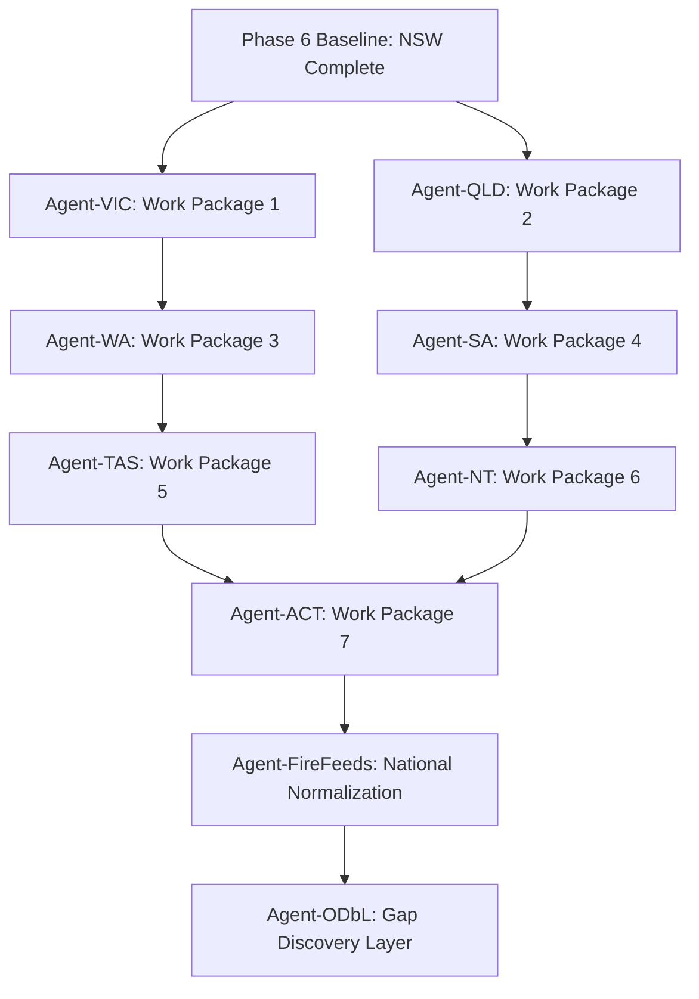

# Camp Smart Australia — National Data Plan & Execution Architecture

> **Document Version:** 1.0.0 (October 2026)  
> **Status:** APPROVED FOR AGENT EXECUTION  
> **Scope:** Nationwide Expansion (NSW Baseline $\to$ VIC, QLD, WA, SA, TAS, NT, ACT, JBT)  
> **Mandatory Agent Guardrails:** Adhere strictly to `AGENTS.md` (`tdd-workflow`, `backend-architect`, `api-patterns`, `ui-ux-designer`, `lint-and-validate`). All tasks must follow the RED-GREEN-REFACTOR cycle with automated integrity gates.

---

## 🧭 Executive Summary & Core Moat

Camp Smart Australia is an **"Answer-First" trip planner** for Australian campers. We reject the legacy model of dumping 65,000 uncurated, crowdsourced dots on a map with broken links, fabricated fee estimates, and stale fire ratings. Our competitive moat rests on three pillars:

1. **Uncompromising Truthfulness & Provenance:** Every claim presented on a Trip Card (access, fees, dog policies, facilities) is backed by either an **official open dataset (CC-BY)**, an authoritative **statutory policy rule**, or a timestamped **fact observation** with source URL and parser version.
2. **Real Safety Feeds with Honest Degradation:** Fire ratings must reflect official emergency services (RFS, CFA, QFD, DFES, CFS, TFS, Bushfires NT, ACT ESA) per district. If an official feed is unreachable or unparsed, the platform **never synthesizes or randomizes a rating**; it renders a prominent, honest degradation banner.
3. **ODbL Legal Isolation:** OpenStreetMap (`tourism=camp_site`) is used strictly in an isolated, read-only discovery layer (`osm_discovery`) to surface missing sites. It is **never mingled with or foreign-keyed to** our canonical database, ensuring our curated database is never subjected to ODbL 1.0 Share-Alike copyleft contamination.

Following the successful execution of the NSW baseline (Phase 6: 715 CC-BY NPWS sites ingested, 4 policy rules seeded, Smartproxy residential evidence harvester deployed, 64 tests passing), this document defines the **state-by-state execution plan** to expand across all of Australia.

---

## 🏛️ System Architecture: The 4-Tier Data Pipeline

```
                                      ┌───────────────────────────────────────────────┐
                                      │           State Open Data Portals             │
                                      │   (Data.Vic, Data.QLD, Data WA, Data.SA, etc) │
                                      └──────────────────────┬────────────────────────┘
                                                             │ 1. CC-BY 4.0 Spatial Ingest
                                                             ▼
                                      ┌───────────────────────────────────────────────┐
                                      │              STAGING TABLES                   │
                                      │     stg_{state}_visitor_areas (SRID 7844/4283) │
                                      └──────────────────────┬────────────────────────┘
                                                             │ 2. SQL Reprojection to EPSG:4326
                                                             │    & Idempotent Natural Key Upsert
                                                             ▼
┌──────────────────────────────┐      ┌───────────────────────────────────────────────┐
│     Land Manager Rules       │      │             canonical_campsites               │
│ (NPWS, Parks Vic, QPWS, etc) │─────▶│    (Verified coordinates, names, access mode, │
│        policy_rules          │      │     data_status: rule_derived / verified)     │
└──────────────────────────────┘      └──────────────────────┬────────────────────────┘
                                                             │ 3. Polite Evidence Harvesting
                                                             ▼
┌──────────────────────────────┐      ┌───────────────────────────────────────────────┐
│      Smartproxy Pool         │─────▶│             harvest_cache &                   │
│   (Residential AU IPs)       │      │              fact_evidence                    │
│   Rate limited / 304 Caching │      │  (Observed amenities, fees, contact URLs)     │
└──────────────────────────────┘      └──────────────────────┬────────────────────────┘
                                                             │ 4. Read-Only Gap Cross-Check
                                                             ▼
                                      ┌───────────────────────────────────────────────┐
                                      │           osm_discovery (ISOLATED)            │
                                      │     ODbL 1.0 Separation - NO Foreign Keys     │
                                      └───────────────────────────────────────────────┘
```

### Tier 1: Canonical Base Ingestion (Open Data CC-BY)
- Ingested directly from official state government GIS packages (Shapefile, GeoPackage, CKAN API, ArcGIS Feature Layer).
- Every ingested record receives a deterministic, immutable natural key:
  $$\text{source\_id} = \text{"<STATE>-<AGENCY>-<HASH>"}$$
- Coordinates are reprojected in PostgreSQL using PostGIS (`ST_Transform(geom, 4326)`) rather than in Python, ensuring sub-meter fidelity.
- Carries verbatim source attributes (`access_type`, `lga`, `management_agency`) so authoritative classifications are never lost.
- **Honest Null Principle:** Missing facilities or fees stay strictly `None` / `NULL`. Never insert plausible guesses.

### Tier 2: Policy Rule Engine (`policy_rules`)
Authoritative land-manager statutory rules cover hundreds of campsites at zero scraping cost and zero legal risk.
- Encoded as versioned database rows in the `policy_rules` table (`land_manager`, `field`, `value`, `evidence_url`, `effective_from`).
- Examples:
  - Dogs in National Parks: strictly banned statewide (NSW, VIC, QLD, WA, SA, TAS, ACT) with explicit legislative citations.
  - Dogs in State Forests: permitted under control statewide (NSW Forestry Corp, VIC DEECA State Forests, ForestrySA).
  - Fees & Booking: QPWS requires online e-permit statewide ($7.75/night); NSW State Forests are $0 free camping with no booking required.

### Tier 3: Polite Evidence Harvester (`harvest.py` + Smartproxy)
For per-campground details (number of sites, flush vs pit toilets, hot showers, drinking water):
- Routed via **Smartproxy Australian residential IP pool** (`settings.PROXY_URL`), with fallback to direct HTTP for whitelisted government endpoints.
- Respects `robots.txt` programmatically (`urllib.robotparser`).
- Bounded concurrency (2–4 workers) and rate-limited to 1–2 req/s.
- **Conditional HTTP requests:** sends `If-None-Match` (ETag) and `If-Modified-Since`. HTTP `304 Not Modified` responses skip re-download.
- **Content-Hash Gating:** SHA-256 hash stored in `harvest_cache`. Re-parsing triggers only when the hash changes.
- Results recorded as atomic audit entries in `fact_evidence`:
  $$\text{FactEvidence}(\text{campsite\_id}, \text{field}, \text{value}, \text{source\_url}, \text{retrieved\_at}, \text{parser\_version})$$

### Tier 4: ODbL 1.0 Discovery Layer (`osm_discovery`)
- OpenStreetMap contains rich community observations, but its **ODbL 1.0 Share-Alike copyleft clause** creates legal contamination risks if joined directly into proprietary databases.
- Kept strictly in a standalone table `osm_discovery` with **zero foreign keys** to `canonical_campsites`.
- Used solely for administrative gap detection: identifying popular campsites present in OSM but missing from official state datasets (e.g. municipal reserves, private stations).

---

## 🗄️ Database Schemas & Migrations

The database models deployed in migrations `b7d2e5f81c04` and `1410cba8a333` form the national foundation:

```sql
-- 1. Canonical Campsites
CREATE TABLE canonical_campsites (
    id SERIAL PRIMARY KEY,
    name VARCHAR(255) NOT NULL,
    state VARCHAR(10) NOT NULL,
    management_type VARCHAR(100) NOT NULL,
    location GEOGRAPHY(Point, 4326) NOT NULL,
    latitude FLOAT NOT NULL,
    longitude FLOAT NOT NULL,
    access_type VARCHAR(100),
    lga VARCHAR(100),
    npws_branch VARCHAR(100),               -- Land manager operational district
    fire_district VARCHAR(100),             -- Mapped to state fire authority district
    dog_friendly BOOLEAN,
    dog_policy_details TEXT,
    rig_access JSONB,                       -- e.g. ["TENT", "CAR", "CARAVAN", "4WD"]
    facilities JSONB,                       -- e.g. {"toilets": true, "showers": false}
    fees VARCHAR(100),                      -- Range or statutory string, e.g. "$7.75/night"
    fee_tier VARCHAR(50),
    booking_status VARCHAR(100),            -- "Booking required", "No booking required"
    booking_url TEXT,
    source_id VARCHAR(100) UNIQUE NOT NULL, -- e.g. "VIC-DEECA-a1b2c3d4", "QLD-QPWS-e5f6g7h8"
    source_url TEXT NOT NULL,
    licence VARCHAR(50) NOT NULL,           -- e.g. "CC-BY 4.0"
    attribution TEXT NOT NULL,
    evidence_url TEXT,
    data_status VARCHAR(20) NOT NULL DEFAULT 'rule_derived', -- rule_derived | verified | unverified
    created_at TIMESTAMP WITH TIME ZONE DEFAULT NOW(),
    updated_at TIMESTAMP WITH TIME ZONE DEFAULT NOW()
);

CREATE INDEX idx_campsites_location ON canonical_campsites USING GIST(location);
CREATE INDEX idx_campsites_state ON canonical_campsites(state);
CREATE INDEX idx_campsites_fire_district ON canonical_campsites(fire_district);

-- 2. Versioned Policy Rules
CREATE TABLE policy_rules (
    id SERIAL PRIMARY KEY,
    land_manager VARCHAR(100) NOT NULL,     -- e.g. "Parks Victoria", "QPWS", "DEECA"
    field VARCHAR(50) NOT NULL,             -- "dog_friendly", "booking_status", "fees"
    value VARCHAR(255) NOT NULL,
    evidence_url TEXT NOT NULL,
    description TEXT,
    effective_from DATE NOT NULL,
    effective_to DATE,
    is_active BOOLEAN NOT NULL DEFAULT TRUE,
    created_at TIMESTAMP WITH TIME ZONE DEFAULT NOW()
);

-- 3. Polite Harvest Cache
CREATE TABLE harvest_cache (
    url VARCHAR(1024) PRIMARY KEY,
    status_code INTEGER NOT NULL,
    etag VARCHAR(255),
    last_modified VARCHAR(255),
    content_hash VARCHAR(64) NOT NULL,
    html_body TEXT,
    retrieved_at TIMESTAMP WITH TIME ZONE NOT NULL,
    parser_version VARCHAR(50) NOT NULL
);

-- 4. Granular Fact Evidence
CREATE TABLE fact_evidence (
    id SERIAL PRIMARY KEY,
    campsite_id INTEGER NOT NULL REFERENCES canonical_campsites(id) ON DELETE CASCADE,
    field VARCHAR(50) NOT NULL,
    value TEXT,
    source_url TEXT NOT NULL,
    parser_version VARCHAR(50) NOT NULL,
    retrieved_at TIMESTAMP WITH TIME ZONE NOT NULL,
    created_at TIMESTAMP WITH TIME ZONE DEFAULT NOW()
);

-- 5. Isolated ODbL Discovery Layer (NO FOREIGN KEYS)
CREATE TABLE osm_discovery (
    osm_id BIGINT PRIMARY KEY,
    name VARCHAR(255),
    state VARCHAR(10),
    location GEOGRAPHY(Point, 4326) NOT NULL,
    tags JSONB,
    licence VARCHAR(50) DEFAULT 'ODbL 1.0',
    discovered_at TIMESTAMP WITH TIME ZONE DEFAULT NOW()
);
```

---

## 🗺️ State-by-State Deep Research & Execution Blueprints

### 1. New South Wales (NSW) — Baseline Complete ✅
* **Land Managers:** NSW National Parks & Wildlife Service (NPWS), Forestry Corporation of NSW.
* **Open Datasets:**
  - SEED / Data.NSW *"Asset Infrastructure: Visitor Area"* (Shapefile, CC-BY 4.0, 715 records ingested).
  - SEED / Data.NSW *"Asset Infrastructure: Facility Point"* (10,287 asset records for toilet/BBQ enrichment).
* **Statutory Facts Seeded:**
  - NPWS: Dogs banned (`dog_friendly=False`, NPW Act s 156A).
  - NPWS: Online booking mandatory statewide (`booking_status="Booking required"`).
  - Forestry Corp: Dogs welcome on leash (`dog_friendly=True`).
  - Forestry Corp: Free camping statewide (`fees="$0 (Free)"`, `booking_status="No booking required"`).
* **Emergency Safety Feed:** NSW RFS XML `https://www.rfs.nsw.gov.au/feeds/fdrToban.xml` (parsed per fire district).
* **Execution Status:** Fully implemented in `seed_npws.py`, `apply_rules.py`, `test_seed_npws.py`, and verified in DB.

---

### 2. Victoria (VIC) — Work Package 1
* **Primary Land Managers:**
  1. **Parks Victoria:** Manages 45 National Parks, 26 State Parks, and 30+ Coastal/Regional Parks.
  2. **DEECA (Department of Energy, Environment and Climate Action):** Manages 3.1 million hectares of State Forest.
* **Authoritative Open Datasets (Data.Vic):**
  - **Dataset 1:** *"DEECA Recreation Sites (State Forest)"* (DataVic ID: `rec-sites`).
    - Format: Shapefile / GeoJSON / WFS.
    - Licence: **CC-BY 4.0**. Commercial reuse permitted.
    - Covers: 250+ designated free camping and picnic sites in State Forests across Victoria.
  - **Dataset 2:** *"Vicmap Features of Interest (Campsites & Caravan Parks)"* (DataVic `vmfeat_geom_point`).
    - Format: GDB / SHP / WFS.
    - Licence: **CC-BY 4.0**.
    - Covers: Statewide spatial asset locations.
  - **Dataset 3:** *"Parks Victoria Camp Grounds and Huts"* (DataVic catalogue).
    - Format: GeoJSON / Shapefile.
    - Licence: **CC-BY 4.0**.
* **Statutory Policy Rules (Zero-Scrape Facts):**
  - **Parks Victoria National Parks:** Domestic dogs are strictly prohibited under the *National Parks Act 1975 (Vic)*.
    - `dog_friendly = False`, citation: `https://www.parks.vic.gov.au/things-to-do/dog-walking`
  - **DEECA State Forests:** Dogs are welcome in Victorian State Forests, must be on leash or under direct control.
    - `dog_friendly = True`, citation: `https://www.exploreoutdoors.vic.gov.au/activities/dog-walking`
  - **Victorian State Forest Camping:** Victorian Government "Explore Outdoors" initiative mandates that camping in all State Forests is **100% free** with no booking required.
    - `fees = "$0 (Free)"`, `booking_status = "No booking required"`, citation: `https://www.exploreoutdoors.vic.gov.au/activities/camping`
  - **Parks Victoria Bookable Sites:** Bookable sites require online booking via the Parks Victoria reservation engine.
    - `booking_status = "Booking required"`, citation: `https://www.parks.vic.gov.au/stay`
* **Emergency Fire Feed (CFA & VicEmergency):**
  - **Source:** CFA Fire Danger Ratings RSS 2.0 / XML feed (`https://www.cfa.vic.gov.au/feeds/`).
  - Updates: Live (per-minute updates during fire season).
  - Format: XML per Victorian fire weather district (Central, North East, Northern Country, North Central, South West, etc.).
  - Total Fire Ban (TFB): Declared per district.
* **Natural Key Format:** `VIC-DEECA-{hash}` or `VIC-PV-{site_code}`.

---

### 3. Queensland (QLD) — Work Package 2
* **Primary Land Managers:**
  1. **QPWS (Queensland Parks and Wildlife Service):** Manages National Parks, Conservation Parks, and State Forest recreation areas under DETSI.
* **Authoritative Open Datasets (Data.QLD):**
  - **Dataset 1:** *"Recreational areas - Queensland"* / *"QPWS managed estate spatial layers"*.
    - Portal: `data.qld.gov.au`.
    - Format: Shapefile / GeoJSON / REST Feature Service.
    - Licence: **CC-BY 4.0**.
    - Covers: All gazetted camping and recreation areas across Queensland.
* **Statutory Policy Rules (Zero-Scrape Facts):**
  - **Mandatory E-Permit / Advance Booking:** Queensland law strictly forbids arriving at any QPWS campground without a pre-purchased camping permit. Self-registration honesty boxes are abolished statewide. Every camper must carry a printed/written camping tag with their booking number.
    - `booking_status = "Booking required (permit must be secured before arrival)"`
    - Citation: `https://parks.des.qld.gov.au/camping/booking-information`
  - **Standardized Statewide Camping Fee:**
    - Standard adult fee: **$7.75 per person per night** (as of 1 July 2026 CPI indexation).
    - Family rate: **$31.00 per family per night** (up to 2 adults and 4 children).
    - Children under 5: **$0.00 (Free)**.
    - `fees = "$7.75/person/night"`, `fee_tier = "QPWS Standard"`
    - Citation: `https://parks.des.qld.gov.au/camping/fees`
  - **Domestic Animals:** Strictly prohibited in all Queensland National Parks under the *Nature Conservation Act 1992*. Allowed on leash in only a small handful of designated State Forest recreation areas (e.g., Inskip Peninsula, Amamoor State Forest).
    - Default QPWS: `dog_friendly = False`, citation: `https://parks.des.qld.gov.au/plan-your-visit/rules`
* **Emergency Fire Feed (Queensland Fire Department / QFD):**
  - **Source:** QFD / QFES Bushfire Alerts CAP-AU (Common Alerting Protocol) XML / RSS feed + BOM AFDRS district fire ratings.
  - Degradation: Degrades to "Status unavailable - consult QFD Bushfire Warnings" if feed is unavailable.
* **Natural Key Format:** `QLD-QPWS-{site_id}`.

---

### 4. Western Australia (WA) — Work Package 3
* **Primary Land Managers:**
  1. **DBCA (Department of Biodiversity, Conservation and Attractions) / Parks and Wildlife Service.**
* **Authoritative Open Datasets (Data WA):**
  - **Dataset 1:** *"DBCA - Campgrounds and Recreation Sites"* / *"DBCA-026 Regional Parks & Facilities"*.
    - Portal: `data.wa.gov.au`.
    - Format: GeoJSON / Shapefile / WFS.
    - Licence: **CC-BY 4.0**.
* **Statutory Policy Rules (Zero-Scrape Facts):**
  - **DBCA National Parks Dog Policy:** Domestic pets are strictly forbidden in all Western Australian National Parks, Nature Reserves, and Conservation Parks (primarily to protect native wildlife and due to active 1080 fox/wild dog baiting).
    - `dog_friendly = False`, citation: `https://exploreparks.dbca.wa.gov.au/pets-in-parks`
  - **Park Stay Booking System:** High-demand campgrounds (Cape Range, Karijini, François Peron, Lane Poole Reserve) require advance online booking via Park Stay WA. Remote bush sites remain first-come, first-served with honesty deposit bags.
    - Citation: `https://parkstay.dbca.wa.gov.au/`
  - **Standard DBCA Camping Fee Tiers:**
    - Basic sites (no facilities or pit toilet only): ~$11.00 per adult per night.
    - Serviced sites (toilets, showers, camp kitchens): ~$15.00–$18.00 per adult per night.
* **Emergency Fire Feed (DFES WA):**
  - **Source:** DFES (Department of Fire and Emergency Services) Public Warnings RSS / CAP feed (`https://www.emergency.wa.gov.au/data/`).
  - Weather Districts: Pilbara, Gascoyne, Goldfields, South West, Great Southern, Lower West.
* **Natural Key Format:** `WA-DBCA-{parkstay_id_or_hash}`.

---

### 5. South Australia (SA) — Work Package 4
* **Primary Land Managers:**
  1. **NPWS SA (National Parks and Wildlife Service South Australia)** under the Department for Environment and Water (DEW).
  2. **ForestrySA:** Manages public forest reserves in the Mount Lofty Ranges and Green Triangle.
* **Authoritative Open Datasets (Data.SA):**
  - **Dataset 1:** *"DEW Protected Areas - Visitor Facilities"* (Location SA / Data.SA).
    - Portal: `data.sa.gov.au`.
    - Format: GeoJSON / ESRI REST API / Shapefile.
    - Licence: **CC-BY 4.0**.
* **Statutory Policy Rules (Zero-Scrape Facts):**
  - **NPWS SA Dog Ban:** Domestic dogs are strictly prohibited in South Australian National Parks and Conservation Parks under the *National Parks and Wildlife Act 1972*.
    - `dog_friendly = False`, citation: `https://www.parks.sa.gov.au/park-management/rules-regulations/dogs-in-parks`
    - Exceptions: Explicitly scheduled recreation parks (e.g. Belair, Para Wirra) have designated dog trails.
  - **Parks SA Booking Engine:** Advance online booking is required for **all** campgrounds managed by NPWSA prior to setting up camp.
    - `booking_status = "Booking required"`, citation: `https://www.parks.sa.gov.au/booking`
  - **ForestrySA:** Dogs are welcome on leash in designated ForestrySA forest plantations (e.g. Kuitpo Forest, Mount Crawford Forest).
    - `dog_friendly = True`, citation: `https://www.forestrysa.com.au/recreation/dogs/`
* **Emergency Fire Feed (CFS SA):**
  - **Source:** SA Country Fire Service (CFS) XML / RSS feed (`https://www.cfs.sa.gov.au/custom/incidents/`).
  - Fire Danger Season & Total Fire Bans parsed by SA Fire Ban District (Adelaide Metropolitan, Mount Lofty Ranges, Kangaroo Island, Flinders, Yorke Peninsula, etc.).
* **Natural Key Format:** `SA-DEW-{site_id}` or `SA-FSA-{site_id}`.

---

### 6. Tasmania (TAS) — Work Package 5
* **Primary Land Managers:**
  1. **Tasmania Parks and Wildlife Service (PWS)** under NRE Tas (Department of Natural Resources and Environment Tasmania).
  2. **Sustainable Timber Tasmania (STT):** Public production forest reserves.
* **Authoritative Open Datasets (The LIST / Data.gov.au):**
  - **Dataset 1:** *"The LIST - Camping and Caravan Sites"* / *"PWS Built Infrastructure"*.
    - Portal: `thelist.tas.gov.au` / `data.gov.au`.
    - Format: Shapefile / GeoJSON / WFS.
    - Licence: **CC-BY 4.0**.
* **Statutory Policy Rules (Zero-Scrape Facts):**
  - **PWS National Parks Pass Requirement:** Entry to any Tasmanian National Park requires a valid Parks Pass (daily, holiday, or annual) **in addition to** any individual camping fee.
    - `booking_policy_details = "Tasmanian National Parks Pass required for park entry + camping fees at select sites."`
    - Citation: `https://parks.tas.gov.au/passes-and-entry`
  - **Domestic Animals:** Strict dog ban in all Tasmanian National Parks under the *National Parks and Reserves Management Act 2002*.
    - `dog_friendly = False`, citation: `https://parks.tas.gov.au/plan-your-visit/parks-pass/dogs-in-parks`
  - **Fuel Stove Only Areas:** Large portions of the Tasmanian Wilderness World Heritage Area (TWWHA) and alpine zones are designated "Fuel Stove Only" (strictly zero campfires).
* **Emergency Fire Feed (Tasmania Fire Service / TFS):**
  - **Source:** TFS Warnings & Fire Danger Ratings GeoJSON / RSS (`https://www.fire.tas.gov.au/`).
  - Degradation: Clear banner during non-declaration periods.
* **Natural Key Format:** `TAS-LIST-{feature_id}`.

---

### 7. Northern Territory (NT) — Work Package 6
* **Primary Land Managers:**
  1. **Parks and Wildlife Commission of the NT (PWCNT)** under DEPWS.
  2. **Parks Australia (Commonwealth):** Kakadu National Park, Uluru-Kata Tjuta National Park.
* **Authoritative Open Datasets (Data NT):**
  - **Dataset 1:** *"NT Parks Visitor Assets & Camping Areas"*.
    - Portal: `data.nt.gov.au` / `nt.gov.au`.
    - Format: GeoJSON / Shapefile / Tabular.
    - Licence: **CC-BY 4.0**.
* **Statutory Policy Rules (Zero-Scrape Facts):**
  - **Categorized Camping Schedule (Statutory Tiers):**
    - **Category A (Moderate Facilities - showers, toilets, bins, water):** $15.00/adult, $8.00/child, $38.00/family.
    - **Category B (Basic Facilities - toilets, tables, tap):** $10.00/adult, $5.00/child, $25.00/family.
    - **Category C (Commercially Managed):** Paid directly to concessionaire.
    - Citation: `https://nt.gov.au/parks/camping/camping-fees`
  - **Mandatory Online Booking:** All NT Government-managed park camping must be booked and paid online prior to arrival via `https://parkbookings.nt.gov.au/`. Cash payment at campsites is prohibited.
    - `booking_status = "Booking required (online only)"`
  - **Crocodile & Water Safety Warnings:** Northern Territory campsites near water bodies must display statutory croc warning alerts.
  - **Pet Restrictions:** Banned in almost all national parks (Litchfield, Nitmiluk, West MacDonnell).
* **Emergency Fire Feed (Bushfires NT & SecureNT):**
  - **Source:** Bushfires NT / SecureNT RSS feed.
* **Natural Key Format:** `NT-DEPWS-{park_code}-{site_name_slug}`.

---

### 8. Australian Capital Territory & Jervis Bay Territory (ACT & JBT) — Work Package 7
* **Primary Land Managers:**
  1. **ACT Parks and Conservation Service (PCS)** under EPSDD.
  2. **Booderee National Park (Parks Australia / Wreck Bay Aboriginal Community)** in Jervis Bay Territory.
* **Authoritative Open Datasets (ACT Open Data):**
  - **Dataset 1:** *"ACT Reserves & Recreation Assets"* (`data.act.gov.au`).
    - Licence: **CC-BY 4.0**.
* **Statutory Policy Rules & Territorial Carve-outs:**
  - **Namadgi National Park:** Dogs prohibited; booking required for campgrounds (Orroral, Honeysuckle, Mt Clear) via `https://www.parks.act.gov.au/`.
  - **Woods Reserve & Kowen Forest:** Designated dog-friendly camping on leash.
  - **JBT Booderee Carve-Out (Fixes R11):** Booderee National Park (Green Patch, Bristol Point, Cave Beach) is physically in Jervis Bay Territory, **NOT NSW**. It is managed by Parks Australia, not NPWS. Must carry `state="JBT"`, `management_type="Parks Australia"`, and link to `parksaustralia.gov.au/booderee`.
* **Emergency Fire Feed (ACT ESA):**
  - **Source:** ACT Emergency Services Agency (ESA) RSS feed (`https://esa.act.gov.au/`).
* **Natural Key Format:** `ACT-PCS-{asset_id}` and `JBT-PA-booderee-{beach_slug}`.

---

## 🤖 Multi-Agent Execution Work Packages

To execute this plan systematically without cross-branch merge conflicts or regressions, work is divided into **8 atomic work packages**. Each package follows the strict **`tdd-workflow`** (write failing tests before implementation) and **`lint-and-validate`** rule.



### 📋 Work Package Breakdown

| Work Package | Target State | Agent Assignment | Core Deliverables | TDD Test File | Status |
|---|---|---|---|---|---|
| **WP-1** | Victoria (VIC) | `Agent-VIC` | `backend/app/ingest/seed_vic.py`<br>VIC policy rules in `apply_rules.py`<br>Data.Vic CC-BY 4.0 parser | `backend/tests/ingest/test_seed_vic.py` | ✅ Complete (360 sites) |
| **WP-2** | Queensland (QLD) | `Agent-QLD` | `backend/app/ingest/seed_qld.py`<br>QPWS flat-fee rules ($7.75)<br>Mandatory permit rule in `policy_rules` | `backend/tests/ingest/test_seed_qld.py` | ✅ Complete (1,000 sites) |
| **WP-3** | Western Australia (WA) | `Agent-WA` | `backend/app/ingest/seed_wa.py`<br>DBCA 1080 pet ban rules<br>DBCA FeatureServer CC-BY 4.0 parser | `backend/tests/ingest/test_seed_wa.py` | ✅ Complete (200 sites) |
| **WP-4** | South Australia (SA) | `Agent-SA` | `backend/app/ingest/seed_sa.py`<br>NPWSA pet ban & online booking rules<br>DEW WaterConnect GeoJSON CC-BY 4.0 parser | `backend/tests/ingest/test_seed_sa.py` | ✅ Complete (361 sites) |
| **WP-5** | Tasmania (TAS) | `Agent-TAS` | `backend/app/ingest/seed_tas.py`<br>The LIST PWS parser<br>National Parks Pass requirement rule | `backend/tests/ingest/test_seed_tas.py` | ✅ Complete (112 sites) |
| **WP-6** | Northern Territory (NT) | `Agent-NT` | `backend/app/ingest/seed_nt.py`<br>PWCNT Category A/B/C fee schedule<br>Data NT parser | `backend/tests/ingest/test_seed_nt.py` | ✅ Complete (96 sites) |
| **WP-7** | ACT & JBT | `Agent-ACT` | `backend/app/ingest/seed_act.py`<br>JBT Booderee carve-out (R11)<br>Data ACT parser | `backend/tests/ingest/test_seed_act.py` | ⏳ Pending |
| **WP-8** | Emergency Feeds | `Agent-FireFeeds` | Multi-state fire router in `fire_status.py`<br>CFA, QFD, DFES, CFS, TFS, ESA feeds<br>Degradation unit tests | `backend/tests/api/test_fire_status.py` | ⏳ Pending |

---

## 🛡️ Automated Integrity Gates & CI Verification

To permanently prevent regressions discovered during the audit (e.g. R7 coordinate drift, R8 templated fees, R9 NPWS booking status, R11 jurisdiction errors), every agent must pass the following SQL integrity gates before marking a work package complete:

```sql
-- GATE 1: Catches R8 - Duplicate templated fees across differing facility profiles
SELECT fees, COUNT(DISTINCT facilities::text) AS facility_profiles, COUNT(*) as site_count
  FROM canonical_campsites
 WHERE fees IS NOT NULL AND management_type NOT IN ('QPWS', 'Forestry Corporation')
 GROUP BY fees
HAVING COUNT(DISTINCT facilities::text) > 3 AND COUNT(*) > 5;
-- PASS CONDITION: 0 rows returned.

-- GATE 2: Catches R7/R13 - Every record marked 'verified' or 'rule_derived' MUST carry evidence
SELECT id, name, state, data_status
  FROM canonical_campsites
 WHERE data_status IN ('verified', 'rule_derived')
   AND (evidence_url IS NULL OR source_url IS NULL);
-- PASS CONDITION: 0 rows returned.

-- GATE 3: Catches R11 - No Jervis Bay Territory sites mislabelled as NSW
SELECT id, name, state
  FROM canonical_campsites
 WHERE name ILIKE '%Green Patch%' OR name ILIKE '%Bristol Point%' OR name ILIKE '%Cave Beach%'
   AND state = 'NSW';
-- PASS CONDITION: 0 rows returned (must be 'JBT').

-- GATE 4: Catches R9 - All national park campsites must reflect booking status
SELECT id, name, state, management_type, booking_status
  FROM canonical_campsites
 WHERE management_type ILIKE '%National Parks%'
   AND booking_status IS NULL;
-- PASS CONDITION: 0 rows returned.
```

---

## 🚀 Execution Checklist for Agents

When an agent begins working on any assigned state:

1. **Step 1 (Red Phase):**
   - Create the unit test file `backend/tests/ingest/test_seed_{state}.py`.
   - Assert natural key generation determinism.
   - Assert exclusion of internal maintenance subareas.
   - Assert honest null preservation (`facilities=None`, `fees=None` unless explicitly derived by statutory rule).
   - Assert correct state code, licence metadata, and evidence URLs.
   - Verify test fails (`pytest` Red).
2. **Step 2 (Green Phase):**
   - Create `backend/app/ingest/seed_{state}.py` using `shapefile` / `pyogrio` / `httpx`.
   - Add state-specific policy rules to `CANONICAL_RULES` in `backend/app/ingest/apply_rules.py`.
   - Run tests until green (`pytest` Green).
3. **Step 3 (Harvest & Verification):**
   - For high-priority pilot catchments within the state, queue top 50 campgrounds through `harvest.py`.
   - Verify Smartproxy residential pool fetches without bans or captcha blockers.
   - Record atomic observations in `fact_evidence`.
4. **Step 4 (Validation & Linting):**
   - Run `pytest` across all backend suites (ensure 64+ tests pass).
   - Run `npx tsc --noEmit` and `npm run lint` in `frontend/`.
   - Run automated SQL integrity gates against the active database.
